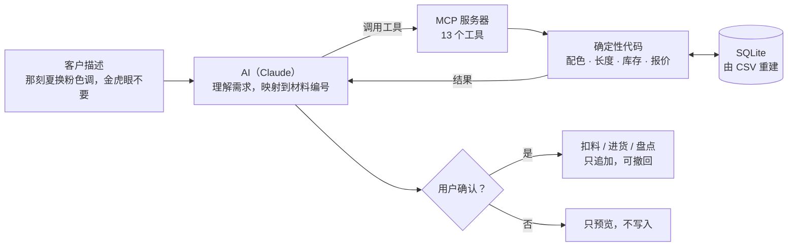

# BeadCraft · 手作业务的 AI 工具链

**模糊的交给 AI，精确的交给程序。**

一个正在被真实使用的小系统：AI 读懂客户的定制描述，程序负责配色、长度、库存、补货和报价。计算不经过大模型，所以幻觉率为 0，同一输入必定同一输出。

<p align="center"></p>

<sub>演示模式录制：成本与供应商字段自动隐藏。流程为接单预览缺料（每次调用都弹窗请求授权）→ 改用量重算 → 查库里有没有某种材料。</sub>

| 数字 | 说明 |
|---|---|
| **0 / 3** | 本引擎遗漏佩戴松量的次数；同输入下通用 AI 助手为 **2 / 2**（[评测报告](评测报告.md)） |
| **162 笔** | 接入的真实订单；材料库 100+ 种 |
| **13 个** | MCP 工具，所有写操作须经人确认，可撤回 |



> 克隆后从空库启动：仓库不含任何真实成本、进价与报价参数，示例数据为虚构。

---

## 一、这个项目要解决的真实问题

我经营一门小生意：按动漫/游戏角色的色彩印象设计手工串珠，接受定制。

一开始我用通用 AI 助手处理选材和报价，遇到两个反复出现的问题：

| 症状 | 我最初的判断 | 实际根因 |
|---|---|---|
| **它会忘** | 需要更长的上下文 | 状态存在对话里，窗口滑过就没了 |
| **配色不准，给了固定模板也守不住** | 提示词写得不够好 | **模型不"看见"颜色** |

第二条是关键。**"雾霾蓝"对模型来说是三个字，不是 `#7A9BB5`。** 它没有色相环、没有我的库存表，它在根据文字联想文字。

而我同时要求它做三件事：理解模糊需求、从我的真实库存里挑、严格套模板。**每件做到 80%，连乘就是 51%。** 优化提示词能把单项推到 85%，连乘 61%。

> **天花板在架构上，不在措辞上。**

---

## 二、核心设计决策：把边界画在哪

| 谁来做 | 做什么 | 为什么 |
|---|---|---|
| LLM | 模糊需求 → 结构化参数（色相、风格标签、预算） | 这是它擅长的：语言理解 |
| **代码** | 查库存、算色差、匹配策略、计算报价、渲染模板 | **可复现、可验证、错了能定位** |
| LLM | 结果 → 自然语言文案 | 同样是语言任务 |
| **人** | **定规则本身**（权重、策略、什么叫好看） | **审美没有 ground truth** |

三条由此而来的性质，**都不是调优得到的，是架构决定的**：

- **幻觉率 0%**：材料来自单一事实来源（CSV），查不到就显式报错，代码里没有"编造"这个分支
- **模板合规率 100%**：输出格式由代码渲染，不依赖模型"记得遵守"
- **可复现性 100%**：无随机性，同输入必定同输出，因此可做回归测试

---

## 三、架构

```
角色意象 / 客户需求
        │
        ▼
  [LLM] 抽取结构化参数 ────────► CharacterBrief
        │
        ▼
┌──────────────────────────────────────────┐
│  配色引擎（palette_engine.py）无 LLM 调用  │
│                                          │
│  可用材料 → 风格/色相筛选 → 按策略配对     │
│         → 协调性校验 → 组装 → 打分排序     │
└──────────────────────────────────────────┘
        │
        ├──► 报价（pricing.py）成本 → 档位 → 售价/底线/定金
        ├──► 订单核算（order.py）长度校验 / 库存匹配 / 采购清单
        │
        ▼
  [LLM] 生成文案（合规版 / 报价版）
```

| 模块 | 职责 | 含 LLM |
|---|---|---|
| `color.py` | 色彩数学：sRGB→LAB、ΔE 色差、色相距离、对比度 | 否 |
| `materials.py` | 材料表读取与筛选（单一事实来源） | 否 |
| `palette_engine.py` | 配色策略、协调性校验、方案打分 | 否 |
| `pricing.py` | 档位判定、售价、议价底线、定金规则 | 否 |
| `order.py` | 订单核算：模糊匹配库存、长度校验、采购清单 | 否 |
| `beadcraft_mcp.py` | MCP 服务器：13 个工具，供 AI 调用 | 否（被 AI 调用） |
| `build_db.py` | 从 CSV 重建 SQLite，校验编号与口径 | 否 |

**配色的判据不是"模型觉得好看"，是可计算的量：** 色相差落在策略窗口内、明暗对比度达标、ΔE 落在 10–95（低于下限两颗珠子会糊成一片，高于上限会花）。

---

## 四、评测结果

完整报告见 [`评测报告.md`](评测报告.md)。**样本 4 单真实订单，n 偏小，因此只对可复现的确定性缺陷下结论。**

| 指标 | 本引擎 | 通用 AI 助手（同输入、同数据） |
|---|---|---|
| 交付率 | **4/4** | 2/3 |
| 幻觉率 | **0/4** | 2/3 |
| 可复现性 | **100%** | 未验证 |
| 物理约束遗漏（佩戴松量） | **0/3** | **2/2** |

**发现的可复现系统性缺陷：**

> 涉及长度计算的订单 **2/2** 均将手围直接作为目标长度、遗漏佩戴松量。其中一次在明确讨论松紧度的前提下仍使用错误基准。按其结论制作会偏紧 3cm。
> 本引擎将松量设为代码常量，该类错误结构上不可能发生。

**对人工估价的复核：**

> 1 单早期人工估价订单，材料成本被低估 **14.7%**。
> 根因：估算时使用记忆中的小包单价（批量价比它低 28%），且用量核算偏低，**两项误差同向叠加，未互相抵消**。

---

## 五、迭代记录：跑真实订单跑出来的缺陷

这一节是这个项目里我认为最有价值的部分。**以下缺陷全部由真实订单触发，不是设计阶段预见的。**

| # | 缺陷 | 怎么发现的 | 处理 |
|---|---|---|---|
| 1 | 档位判定将「需采购」误判为「专用料」，标准款被错判为高配款 | 第 1 单报价异常偏高 | ✅ 已修：拆分两个概念 |
| 2 | 库存校验功能**对真实业务模式完全无效**：我不囤货、每单现买 | 用户（我自己）指出 | ✅ 已解决：MCP 智能体按单算缺料与补货量（见第七节） |
| 3 | `尺寸mm` 字段在圆珠与隔片上语义不同（直径 vs 厚度），长度计算出现约 3 倍偏差 | 第 4 单长度算出 4.2 圈，明显不合理 | ✅ 已修：新增「穿线长mm」，长度按一颗在绳上实际占多长计算；规格尺寸只用于匹配材料 |
| 4 | 单价未绑定采购批量，批量价比小包价低 **28%** | 第 4 单成本复核 | 🟡 部分解决：供应渠道表记录每家购买规格，可人工比价；未做自动选价 |
| 5 | 定价公式缺少复杂度维度：材料成本相同时，20 颗单圈与 69 颗三圈的工时差约 3 倍，报价却相同 | 第 1 单 | ⏸️ **已识别，暂不修** |

**关于第 5 条为什么不修：** 当订单材料成本上升后，现有加价规则自然落入合理区间，当前所有订单的报价结果均正确。**不为一个原则去改动一个已经正确的结果**：记录下来，等出现「材料便宜但工时极长」的反例时再动。

---

## 六、几条产品判断

**1. 缺失数据有三种处理策略，前两种都不可用**

| 策略 | 后果 |
|---|---|
| 编造一个合理数值 | 结果错误且**不可察觉** |
| 拒绝交付、反复索要 | 安全但**无用**，成本转回用户 |
| **带标注估算 + 完整交付** | 立即可用，且不确定性可见 |

> 不确定性不应阻止交付，应当被量化并随交付一同给出。

**2. 「减少幻觉」与「保持可用」是一对需要设计的权衡**

对照测试中，通用助手在第 3 单表现得更谨慎（不再编造），代价是完全无法交付。**两者不是同向优化的目标**，仅靠提示词拿不到，必须在架构层面处理。

**3. 并非所有估算都需要精确，只有「占比大 × 波动大」的项才需要**

对某单做敏感度分析（单项估错 50% 对最终报价的影响）：

| 材料 | 占成本 | 报价影响 | 结论 |
|---|---|---|---|
| 金运石 | 40.8% | | 必须确定 |
| 金轴+挂件 | 6.8% | | 估算即可 |
| 金曜石 | 1.8% | | 忽略 |

> 工作不是把所有数算准，而是先算出哪些数值得算准。

**4. 有些功能"能做但不该做"**

自动抓取角色立绘做配色参考，技术上可行，但：一年仅数十个角色、手动录入每个约 2 分钟；自动检索易抓错图、稳定性差；且存在版权风险。**判断是不做。**

---

## 七、MCP 智能体：让 AI 接入真实业务（2026.09–10）

配色引擎解决的是"推荐什么"。实际接单时更常见的问题是：**客户的定制描述千变万化，料够不够、缺多少、该补什么？** 这部分做成了一个 MCP 服务器（`beadcraft_mcp.py`），接入 Claude Desktop 等支持 MCP 的客户端。

**分工原则不变：模糊的交给 AI，精确的交给程序。**
- AI 负责：读懂"那刻夏换粉色调，金虎眼不要"这类描述，映射到材料编号
- 程序负责：库存、缺料、补货量、成本与报价，全部是确定性计算

**13 个工具**

| 类别 | 工具 |
|---|---|
| 查询（只读） | 查材料、查配方、列款式、预览一单缺料、报价、只读 SQL |
| 写入（须用户确认） | 扣料、撤回、进货、盘点、加材料、加备选渠道、换首选渠道 |

**几条设计约束**
- **人在回路**：所有写操作都在工具说明里要求先预览、经用户确认后才执行；客户端也会逐次弹窗授权
- **数据可追溯**：CSV 是唯一事实源；库存变动只追加、不覆盖，撤回是追加一条负数记录
- **口径先于代码**：库存 = 盘点数 − 盘点时刻之后的变动；没有盘点时间的库存一律视为"未盘点"，不当作 0
- **演示模式**：设置 `BEADCRAFT_DEMO=1` 后，输出自动隐藏单价、供应商与备注，并关闭自由 SQL，便于录屏和对外展示

**迭代中修掉的口径缺陷**：未盘点库存被当作 0；同日先盘点后接单不扣料；整串五金被余量规则翻倍；数据库被其他程序占用时重建失败。

---

## 八、运行

```bash
python -m src.palette_engine    # 配色方案
python -m src.pricing           # 报价与议价规则
python build_db.py              # 由 CSV 重建 SQLite 数据库
```

配色与报价引擎仅依赖 Python 标准库。MCP 服务器需要 MCP Python SDK（v2）：

```bash
uv add "mcp[cli]>=2"
uv run beadcraft_mcp.py         # 由 MCP 客户端以 stdio 方式启动
```

**首次使用**：克隆后没有任何经营数据，缺失的表会自动建成空表，从你自己的空库开始；报价参数使用代码中的示例值，可在 `data/pricing.json` 中覆盖（该文件不进仓库）。

**关于数据：** 材料成本与供应商信息构成经营核心，不适合公开。仓库提供结构完全一致的脱敏样例数据 `data/materials.sample.csv`（价格已扰动、店名已匿名），真实数据经 `.gitignore` 排除。**所有功能与测试均可基于样例数据完整运行。**

---

## 九、下一步

- [ ] 补充样本至 8 单，使概率型指标可用
- [ ] 完成缺陷 #4（按采购批量自动选价）
- [ ] 参数网格搜索：色相权重 vs 覆盖率的权衡曲线
- [ ] 自动化测试：把「幻觉率 0%」「必含松量」写成可执行断言
- [ ] MCP 工具调用评测：用真实接单描述测试工具选择与参数映射的准确率
